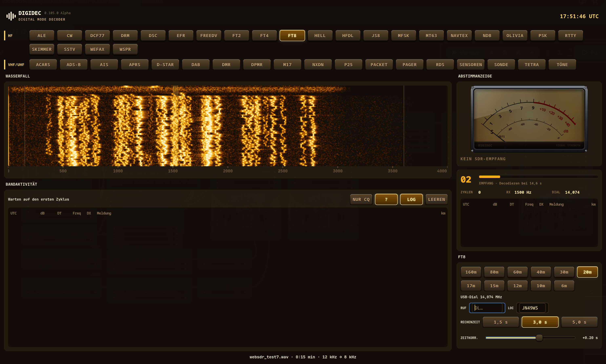

# Digidec unter Linux

Digidec läuft unter Linux mit derselben Swift-Quelle und derselben Oberfläche wie am Mac: Die SwiftUI-Ansichten aus `Sources/UI`
werden unverändert übersetzt, gegen eine eigene SwiftUI-Teilmenge auf GTK 4, Cairo und Pango (`Linux/UIKit`). Die Karte (Apple Karten am Mac)
zeigt unter Linux OpenStreetMap. Branch `linux-port`.



## Bauen und installieren

```bash
./build_linux.sh                       # Release bauen, nach ~/.local installieren (bin/, lib/digidec/, Starter, Symbol)
./build_linux.sh --prefix /usr/local   # anderer Zielort
./build_linux.sh --no-install          # nur bauen; Ergebnis unter dist/linux/
./build_linux.sh --uninstall
digidec                                # starten
digidec 'digidec://open?mode=ft8'      # Auftrag wie von den Commandern am Mac (läuft Digidec schon, übernimmt die laufende Instanz)
```

Die Installation trägt Digidec als Programm für `digidec://`-Adressen ein (`xdg-mime`), legt das Symbol in sieben Größen ab und prüft
den Starter mit `desktop-file-validate`, falls vorhanden.

Voraussetzungen zum Bauen (Namen für Arch; Debian/Fedora sinngemäß): Swift 6, `gtk4`, `pango`, `cairo`, `libpulse`, `libsndfile`, `libpng`, `libjpeg`.
Zur Laufzeit optional: `libfdk-aac` (xHE-AAC bei DRM, wird mit `dlopen` geladen), `pactl` (PulseAudio/PipeWire), `xdg-open`, `poppler` (`pdftotext`),
`libsecret` (`secret-tool` für Schlüssel), `libhackrf`, `librtlsdr`, SDRplay-API (SDR-Hardware, mit `dlopen` geladen).

Entwicklung:

```bash
swift build --product digidec-linux
DIGIDEC_MODULE=ft8 DIGIDEC_PLAY_FILE=aufnahme.wav .build/debug/digidec-linux
swift build -c release --product logic-tests && .build/release/logic-tests     # die Logiktests von macOS (7191 Prüfungen)
LT_ONLY=ft8,dab .build/release/logic-tests                                     # einzelne Gruppen
```

Umgebungsvariablen für Entwicklung und Schnappschüsse: `DIGIDEC_MODULE`, `DIGIDEC_PLAY_FILE`, `DIGIDEC_THEME` (night, amber, redNight, marine),
`DIGIDEC_MAPLAYOUT` (list, map, split), `DIGIDEC_MAP_VIEW="Breite,Länge,Spanne"`, dazu die modulbezogenen (`DIGIDEC_ADSB_FILE`, `DIGIDEC_AIS_NMEA`, …).
Ohne sichtbares Fenster zeichnen: `DIGIDEC_SNAPSHOT=bild.png` (mit `DIGIDEC_SNAPSHOT_AFTER`, `_WIDTH`, `_HEIGHT`) schreibt ein Bild und beendet das Programm;
`DIGIDEC_SCRIPT=ablauf.txt` spielt Bedienschritte ab (`wait`, `click x y`, `drag …`, `scroll …`, `key`, `shot datei.png`, `open <fenster>`,
`close <fenster>`, `quit`); mit `DIGIDEC_SCRIPT_LIVE=1` im echten Fenster. Fensterkennungen: `main`, `ship-info`, `aircraft-info`, `assistant`.

## Aufbau

| Pfad | Inhalt |
|---|---|
| `Linux/UIKit/` | Eigene SwiftUI-Teilmenge (Modul `DigidecSwiftUI`, in den Quellen als `import SwiftUI`): Ansichtsbaum, Layout nach SwiftUI-Regeln, Zustand (`@State`, `@Binding`, `@ObservedObject`, `@AppStorage` …), Umgebung, Formen, Canvas mit `GraphicsContext` auf Cairo, Text mit Pango, Bedienelemente, Gesten, Menüs, Blätter, Popover, Bilder und Symbole, GTK-Fenster |
| `Linux/App/` | Programmstart: Fenster und Hooks (Übersetzung, Zwischenablage, Dateidialog), Stil der Eingabefelder |
| `Linux/Shims/…` | Ersatzmodule für Apple-Frameworks, damit `import Combine`, `import Accelerate` usw. im Quelltext unverändert bleiben |
| `Linux/excluded-files.txt` | Dateien, die unter Linux nicht übersetzt werden (macOS-Programmstart, Kartenbild-Export, Assistent-Bild) |
| `Sources/**/*+Linux.swift`, `#if canImport(…)` | Linux-Fassungen von Audio, Aufnahme, Wiedergabe, Geräteliste, Tastenbund, PDF, Karte, Empfangstext, QRZ |

Ersatzmodule: `os` (Sperren), `Accelerate` (vDSP: FFT, Skalarprodukte, Fenster …, an einer naiven DFT geprüft), `Combine` (OpenCombine plus
`CombineLatest`/`MergeMany`), `CryptoKit` (swift-crypto), `CoreGraphics` und `ImageIO` (Rasterbild, PNG/JPEG über libpng/libjpeg),
`UniformTypeIdentifiers`, `Network` (TCP über POSIX-Sockets), `SwiftUI` (die Teilmenge oben), `AVTestShim` (nur für die Logiktests).

Die Instrumente (S-Meter, Tasten) teilen sich den Zeichencode mit dem Mac (`Sources/Instruments/*Painter.swift`).

## Leistung

Die Oberfläche zeichnet in eine dauerhaft gehaltene Bildfläche (`DGCanvas`, GTK-Widget mit eigener Textur) und malt nur Bereiche neu, deren Ansichten sich
sichtbar geändert haben (`Linux/UIKit/Damage.swift`). Schatten, Textlayouts und Bitmaps werden zwischengespeichert; unter Last drosselt der Host die
Live-Aktualisierung selbst. Messen und Prüfen: `DIGIDEC_TRACE_FRAMES=1` (Zeichenzeit je Bild, Schadensfläche), `DIGIDEC_TRACE_SHAPES=1`,
`DIGIDEC_TRACE_DAMAGE=1` (warum ein Bereich neu gezeichnet wird), `DIGIDEC_VERIFY_DAMAGE=1` (vergleicht jedes Teilbild mit einem Vollbild),
`DIGIDEC_SCRIPT_LIVE=1` (Skript im echten Fenster), `DIGIDEC_FULL_REDRAW=1` (Teilzeichnen aus).

## Was unter Linux anders ist

- **Ton aus/ein:** PulseAudio-Schnittstelle (läuft mit PipeWire): `PullAudioOutput`, `VoicePlayer`, `LiveAudioCapture`. Geräteliste über `pactl`.
- **Datei-Wiedergabe und Aufnahme:** libsndfile (WAV, AIFF, FLAC, OGG, …).
- **xHE-AAC (DRM):** libfdk-aac, zur Laufzeit geladen. FFmpegs USAC-Decoder verarbeitet die Beispieldatei nicht (MPS212 mit SBR 8:3), FDK schon.
- **Karte:** OpenStreetMap-Kacheln (`tile.openstreetmap.org`, zwischengespeichert unter `~/.cache/digidec/tiles`), Nachtdarstellung durch Umfärben der Kacheln,
  Satellit und Hybrid mit Esri World Imagery. Punkte, Wege, Großkreise, Isobaren und Farbflächen wie am Mac; Bild speichern nach `~/Documents/Digidec/Maps`.
  Bitte die Nutzungsbedingungen der Kartendienste beachten (Quellenangabe steht auf der Karte).
- **QRZ.com:** öffnet den Standardbrowser (kein eingebetteter Web-Inhalt).
- **Lokalisierung:** `String(localized:)` liest `Localizable.strings` aus `<Sprache>.lproj` neben dem Programm; Sprache aus `DIGIDEC_LANG`, `LC_ALL`, `LANG`.
- **Ressourcen:** liegen neben dem Programm (`build_linux.sh` kopiert sie), wie am Mac im Bundle.
- **Bedienung:** Rechtsklick = Kontextmenü; Mausrad über dem Wasserfall stimmt ab, mit Alt wird gezoomt.
- **Menü:** Der Menüknopf in der Kopfleiste des Hauptfensters (oder F10) enthält, was am Mac in der Menüleiste steht: Über Digidec,
  Sprache / Language (System, Deutsch, English; wirkt nach dem angebotenen Neustart) und Digidec beenden (Strg+Q).
- **Eine Instanz:** Ein zweiter Start reicht seine Aufträge (`digidec://…`) über D-Bus an das laufende Digidec weiter und endet sofort.
- **Beenden:** Strg+Q, Menü, Schließen des letzten Fensters sowie SIGTERM, SIGINT und SIGHUP beenden geordnet: laufende Aufnahmen werden
  abgeschlossen, SDR-Geräte geschlossen, der Web-Server beendet (wie `applicationWillTerminate` am Mac).
- **Audio-Eingang:** Bricht der Ton-Server ab (PipeWire/PulseAudio neu gestartet, Gerät entfernt), meldet die Statuszeile das und
  Digidec verbindet sich alle 3 s neu. WAV-Aufnahmen begrenzen übersteuerte Werte und halten den Dateikopf laufend aktuell.
- **Web-Server:** wie am Mac im lokalen Netz erreichbar, ohne Anmeldung. Der WebSocket nimmt nur Verbindungen der eigenen Dashboard-Seite an
  (Prüfung von `Origin` gegen `Host`), damit keine fremde Webseite im Browser Digidec steuern kann. Ein Funkgerät hinter rigctld stimmt der
  Browser nur ab, wenn QSY AUTO an ist (wie in der App). Wer den Server nicht im LAN haben will, sperrt den Port in der Firewall.

## Grenzen

- Markdown-Auszeichnung im KI-Assistenten und in der Info-Seite erscheint als reiner Text.
- Die Karte kennt keinen Kompass und keine Neigung; Hochzoomen endet bei Stufe 18.
- Logiktests: `FakeSDRconnect` (braucht WebSocket aus Network.framework) fehlt.
- SDR-Hardware (HackRF, RTL-SDR, SDRplay) wurde unter Linux nicht mit Geräten geprüft; die Bibliotheken werden über übliche Pfade gesucht (`/usr/lib`, `/usr/local/lib`).
  Einrichtung siehe unten.
- Hann-Fenster (`vDSP_HANN_NORM`): Skalierung nach Apples Beschreibung nachgebildet, nicht am Mac verglichen.
- Vor dem Zusammenführen mit `main` am Mac bauen und die Logiktests laufen lassen (alle Änderungen liegen hinter `#if`).

## SDR-Geräte einrichten

Digidec lädt die Gerätebibliotheken zur Laufzeit; ohne sie laufen alle anderen Quellen weiter.

- **RTL-SDR:** `librtlsdr` installieren (Arch: `rtl-sdr`, Debian/Ubuntu: `librtlsdr0` und `rtl-sdr`). Der Kernel bindet den Stick sonst als
  DVB-T-Empfänger: `echo 'blacklist dvb_usb_rtl28xxu' | sudo tee /etc/modprobe.d/blacklist-rtlsdr.conf`, danach Stick neu einstecken.
  Die Paketquellen bringen udev-Regeln mit (Zugriff ohne root); prüfen mit `rtl_test`.
- **HackRF:** `libhackrf` (Arch: `hackrf`, Debian/Ubuntu: `libhackrf0` und `hackrf`), Zugriffsrechte über die mitgelieferten udev-Regeln
  (Gruppe `plugdev` bzw. `uaccess`); prüfen mit `hackrf_info`.
- **SDRplay:** API 3.x von sdrplay.com installieren (legt `libsdrplay_api.so.3` und den Dienst `sdrplay` an); der Dienst muss laufen.
- **SDRconnect** (SDRplay über das Netz) braucht keine Bibliothek.

Nach dem Einrichten genügt ein Neustart von Digidec; Gerätefehler stehen in der Statuszeile der SDR-Karte.
